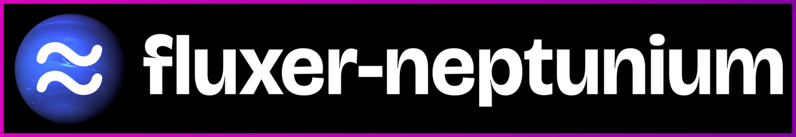

A collection of crates for interacting with the Fluxer API and gateway. The crate which most bot creators will be interested in is `fluxer-neptunium` (which is a bot framework). Heavily inspired by [twilight-rs](https://github.com/twilight-rs/twilight).

Fluxer-neptunium supports user-bots too! Enable the `user_api` feature and look at the `user-bot` example to see how to let fluxer-neptunium know that your token is a user token. User bots are allowed on Fluxer as long as they don't spam.

Support & Development community on Fluxer: https://fluxer.gg/R67sLSVp

# Usage
Add the `fluxer-neptunium` crate and `tokio` (`tokio` is the bare minimum, but I also highly recommend `tracing-subscriber` to be able to see the logs). Check out the examples for examples on how to use the crate. 

You can also use and combine any of `neptunium-model`, `neptunium-http`, `neptunium-gateway`, `neptunium-cache-inmemory` and `fluxer-neptunium` if you want/need more fine-grained control (or if you want to make a custom fluxer __server__ software).

# Examples
Examples can be found in the [examples/](./examples) directory, with a .png for some examples to show what they do.

Run an example using `FLUXER_TOKEN="<token>" cargo run --example <example>`, replacing `<token>` with the bot token and `<example>` with the example name. To run the replying-to-ping example, use `FLUXER_TOKEN="<token>" cargo run --example replying-to-ping`.

To run the `user-bot` example, you need to specify `FLUXER_USER_TOKEN` instead.

# Third party code
I have copied certain audit log schemas from twilight-rs, along with using `twilight-http-ratelimiting` for the rate limiting (currently `twilight-http-ratelimiting` is a modified version directly in `neptunium-http` until the next version releases which will fix a wrong debug assertion).

Copyright (c) 2019 (c) The Twilight Contributors. See [THIRD_PARTY_LICENSES](./THIRD_PARTY_LICENSES) for the full license text.

# License

Licensed under either of:

- MIT License ([LICENSE-MIT](./LICENSE-MIT) or https://opensource.org/license/MIT)
- Apache License, Version 2.0 ([LICENSE-APACHE](./LICENSE-APACHE) or https://www.apache.org/licenses/LICENSE-2.0)

at your option.

<a href="https://brainmade.org">
 	<picture>
    <source media="(prefers-color-scheme: dark)" srcset="https://brainmade.org/white-logo.svg">
    <source media="(prefers-color-scheme: light)" srcset="https://brainmade.org/black-logo.svg">
    
  </picture>
</a>